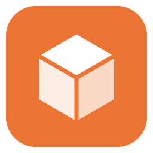
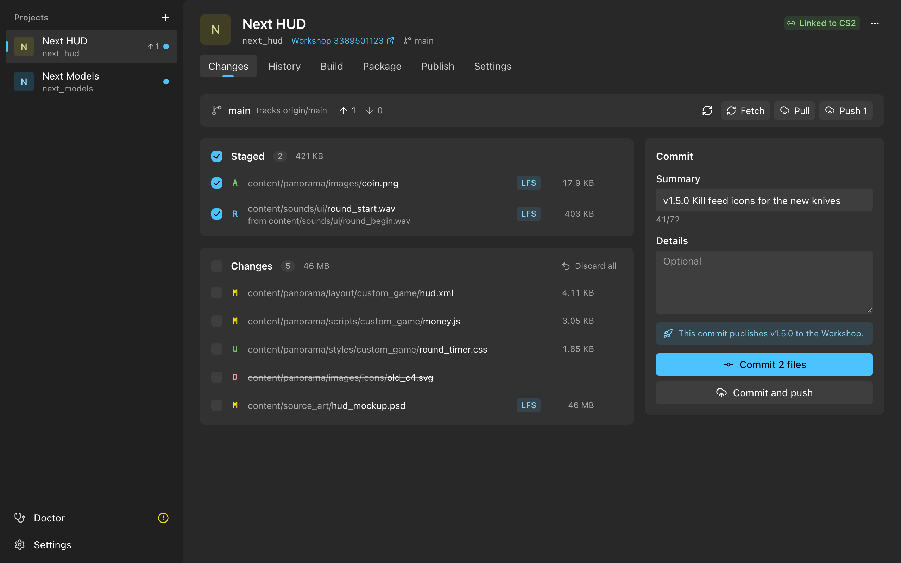
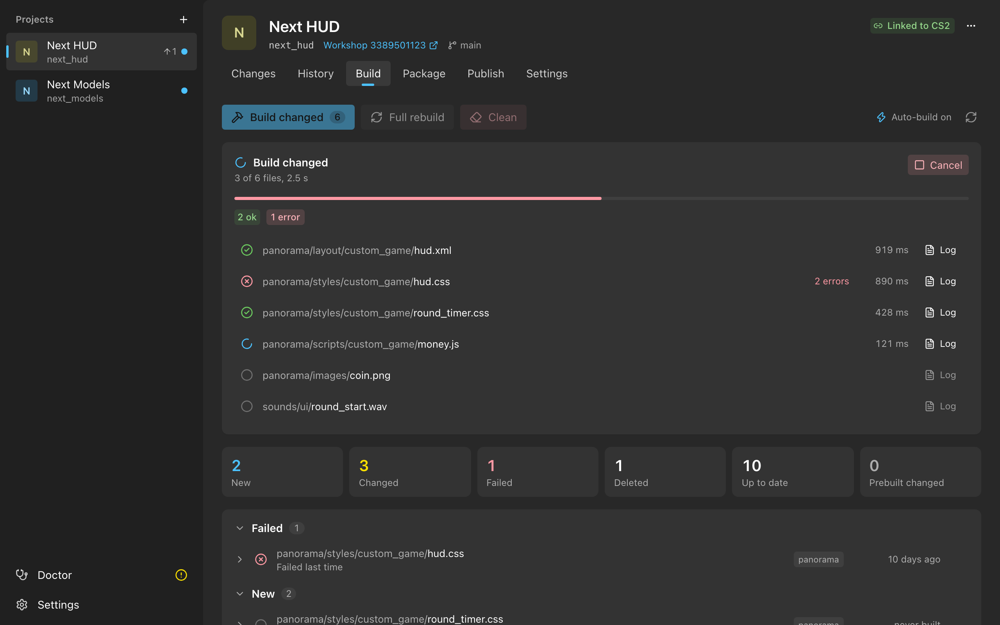
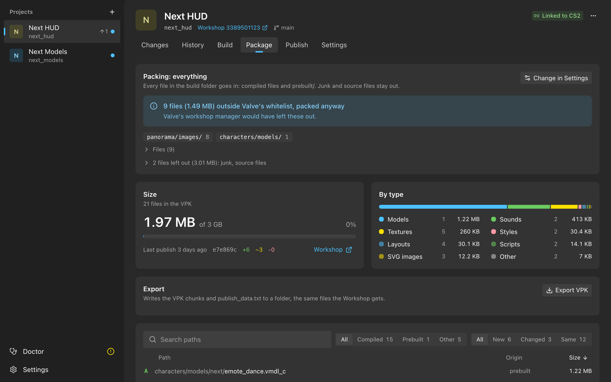
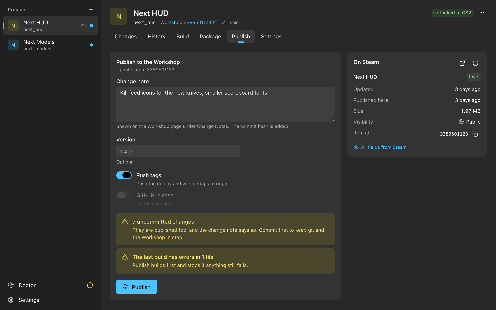
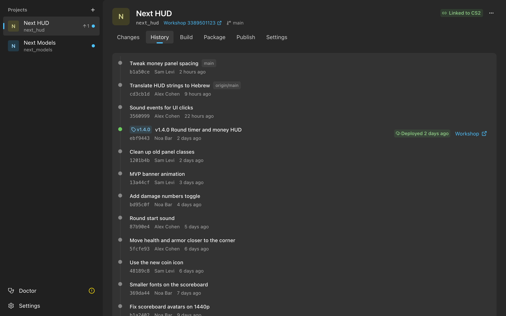
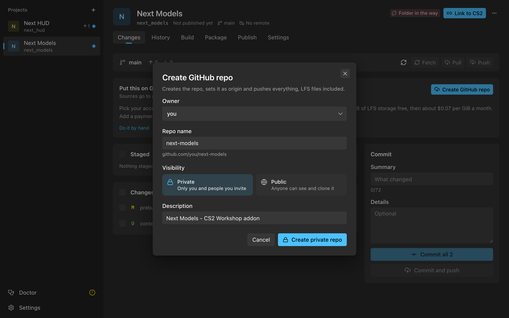
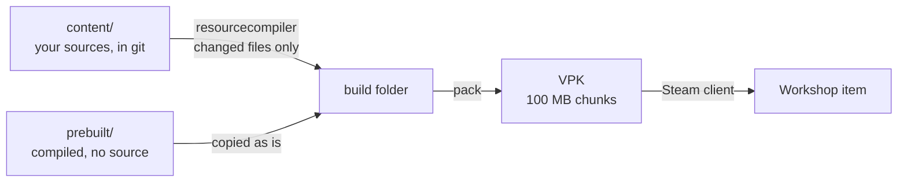

<p align="center">
  
</p>

<h1 align="center">Addon Studio</h1>

<p align="center">
  Your CS2 Workshop addons as git repos.<br>
  Build only what changed, see exactly what goes into the VPK, publish with one click.
</p>

<p align="center">
  <a href="https://github.com/ShiNxz/AddonStudio/releases"></a>
</p>

<p align="center">
  
  <a href="https://github.com/ShiNxz/AddonStudio/actions/workflows/app.yml"></a>
  <a href="LICENSE"></a>
</p>

<p align="center">
  
</p>

## Why

Making a CS2 Workshop addon usually means two folders kept in sync by hand (`content/` with your sources and `game/` with what the compiler wrote), Valve's workshop manager to upload it, and no history at all. Addon Studio keeps the sources in git and treats everything else as build output:

- **One folder, in git.** Only `content/` (and `prebuilt/` for compiled files you have no source for) is tracked. The build folder is regenerated, never edited.
- **Builds only what changed.** A file is rebuilt when it, or anything it references (images, includes, materials), changes. Every file gets its own result and compiler log, so a stylesheet that fails to compile can't slip through unnoticed.
- **You see the VPK before it ships.** Every file, its size, where it came from, and what changed since the last upload.
- **Publishing is one click**, or automatic on a commit named `v1.2.3`. Each publish tags the commit, so History shows what went live and when.

## A quick tour

<table>
  <tr>
    <td width="50%"></td>
    <td width="50%"></td>
  </tr>
  <tr>
    <td><b>Build.</b> Changed files only, live per-file progress, a log for every file, auto-build on save.</td>
    <td><b>Package.</b> What goes into the VPK, by type and origin, against the size cap, diffed with the last publish.</td>
  </tr>
  <tr>
    <td></td>
    <td></td>
  </tr>
  <tr>
    <td><b>Publish.</b> Change note, version, warnings before you upload, and the item's status on Steam.</td>
    <td><b>History.</b> Every commit, version tags and a Deployed badge on the commits that went live.</td>
  </tr>
</table>

<p align="center">
  
  <br>
  <sub>Put a project on GitHub from the app: your account or any of your organizations, public or private, Git LFS for the big files.</sub>
</p>

## How it works



- The build folder is CS2's own `game/csgo_addons/<addon>`. Your project's `content/` folder is linked into CS2's `content/csgo_addons/<addon>`, so Valve's compiler finds it where it expects it. Your repo can live anywhere.
- Models taken from other Workshop items, compiled maps and anything else you only have in compiled form go in `prebuilt/` and are packed as they are.
- The VPK gets everything in the build folder except Valve's tool cache, junk and raw sources CS2 never loads. Prefer Valve's own whitelist behaviour? Turn on "Valve whitelist only" in the project's settings.
- Uploads go through the Steam client that is already running and logged in. No passwords or Steam Guard codes go through the app.
- Every publish tags the commit (`deploy/<time>`, plus `v<version>` when you give one), so History shows what went live.

## Getting started

**You need:** Windows 10 or 11, CS2 with the **Counter-Strike 2 Workshop Tools** DLC (Steam > CS2 > Properties > DLC), Steam running, and [Git for Windows](https://git-scm.com/download/win) (it includes Git LFS). The [GitHub CLI](https://cli.github.com) is optional, for creating repos and releases from the app.

1. **Download `AddonStudio.exe`** from [Releases](https://github.com/ShiNxz/AddonStudio/releases). It is one file: no installer, nothing next to it. Windows SmartScreen may warn because it is not signed: More info > Run anyway.
2. **Open Doctor** in the sidebar. It checks CS2, the Workshop Tools, Steam, git, LFS and the GitHub CLI and tells you how to fix whatever is missing.
3. **Add a project.** Import an addon you already have in CS2 (it copies the sources, decompiles what comes back cleanly and puts the rest in `prebuilt/`), clone one from git, or start a new one.
4. **Build**, check it in game, then **publish**. Try a new unlisted item first before you update one people are subscribed to.

The full walk-through, with what to send back when something fails, is in [docs/WINDOWS-TESTING.md](docs/WINDOWS-TESTING.md).

## An addon project

```
my-hud/
  workshop.json    title, Workshop id, visibility, tags, pack rules, auto-build and auto-publish
  content/         sources: panorama xml/css/js, images, sounds, vmat, vmdl, vpcf...
  prebuilt/        compiled files without source, packed as they are
  preview.png      Workshop thumbnail
```

```jsonc
{
  "addon": "my_hud",
  "workshopId": "3389501123",          // filled in after the first publish
  "title": "My HUD",
  "visibility": "public",
  "tags": ["Custom"],
  "autoBuild": true,                   // rebuild changed files when you save
  "autoPublish": { "enabled": true, "pattern": "^v(\\d+\\.\\d+\\.\\d+)\\b" }
}
```

With `autoPublish` on, a commit called `v1.5.0 Kill feed icons` builds, uploads, tags `v1.5.0` and (if you want) attaches the VPK to a GitHub release.

## GitHub and Git LFS

Images, sounds, models and everything in `prebuilt/` go through Git LFS, so a 3 GB addon still clones fine. GitHub gives 10 GiB of LFS storage free, then about $0.07 per GiB a month. Setup and costs: [docs/GITHUB-LFS.md](docs/GITHUB-LFS.md).

## FAQ

**Does it run on macOS or Linux?**
No. Valve's resource compiler and the Steam Workshop upload only work on Windows, and Addon Studio does not use Wine.

**Can an addon be bigger than 3 GB?**
3 GB is Valve's own upload limit and the default. You can raise the cap in Settings, but bigger uploads are untested.

**Can it compile maps?**
No, maps need Hammer. Compile them there and drop the compiled map into `prebuilt/`.

**Where does it keep its data?**
Settings in `%APPDATA%\AddonStudio`. The exe unpacks its .NET core once per version to `%LOCALAPPDATA%\dev.addonstudio.app\core\`. Put an empty `portable.txt` next to the exe to keep settings beside it instead.

**Is this made by Valve?**
No. Addon Studio is not affiliated with Valve. Valve's compiler is not included: it comes from your own CS2 Workshop Tools install.

## Building from source

Tauri 2 (React + HeroUI v3) for the UI, a .NET 10 core for the build, pack and upload work, embedded in the exe. See [docs/DEVELOPMENT.md](docs/DEVELOPMENT.md) for the layout, mock mode for UI work in a browser, and how CI builds the exe. [docs/SPEC.md](docs/SPEC.md) is the contract between the parts.

## Credits

Packing and Steam upload follow [CS2 Workshop Manager](https://github.com/Angel-foxxo/CS2-Workshop-Manager) by Angel. VPKs are written with [ValvePak](https://github.com/ValveResourceFormat/ValvePak) and imports decompiled with [ValveResourceFormat](https://github.com/ValveResourceFormat/ValveResourceFormat). Details in [THIRD_PARTY_NOTICES.md](THIRD_PARTY_NOTICES.md).

[MIT](LICENSE)
